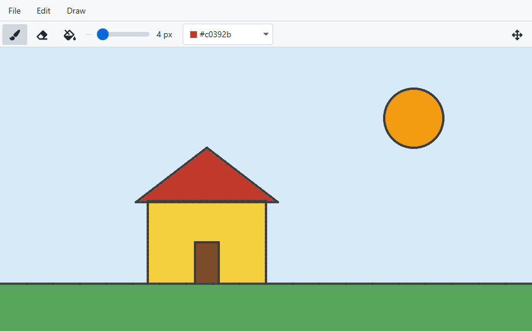
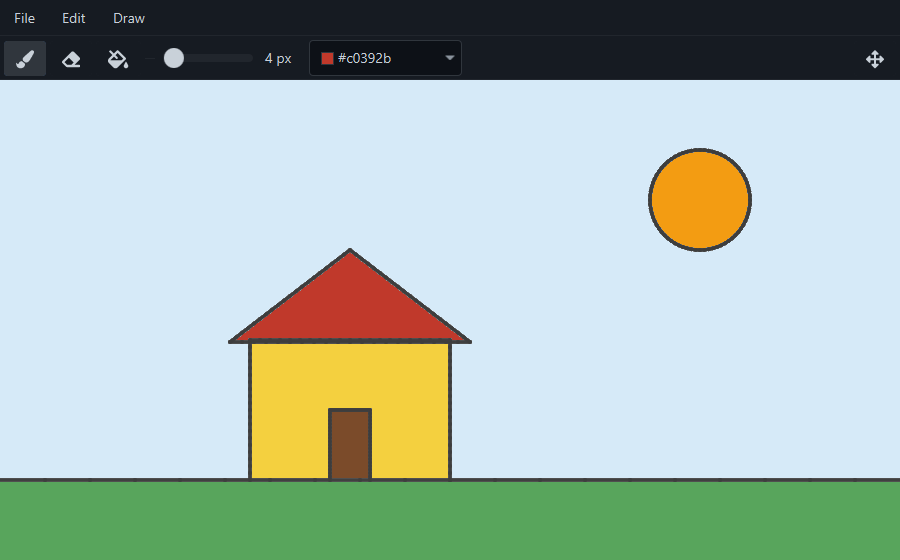

# Peint - A Simple Paint App in JavaFX

## Description
Peint is a simple paint application built in JavaFX, inspired by classic Paint tools.

| Light mode | Dark mode |
|------------|-----------|
|  |  |

## Features
- **Tools**: Pick a tool from the toolbar or the *Draw* menu; it stays selected until you pick another.
  - **Brush**: Click and drag to draw, in the color chosen in the color picker.
  - **Eraser**: Drag to erase back to the white canvas; the cursor shows the eraser's size.
  - **Fill**: Click an area to fill it with the current color (the cursor turns into a crosshair).
- **Tool settings**: Set the brush's and the eraser's line width (1–50 px), and how different a color may be and still be filled (the fill tolerance). Each tool keeps its own setting.
- **Undo / Redo**: Step back and forward through up to 50 changes from the *Edit* menu. Only the area a change touched is kept, so even large images can be undone many steps.
- **Clear**: Wipe the canvas from the *Edit* menu (can be undone).
- **Open / Save**: Open PNG, JPEG (including `.jfif` and CMYK), BMP and GIF images onto the canvas, and save the canvas as PNG, JPEG, BMP or GIF (GIF keeps at most 256 colors). Photos are turned upright by their EXIF orientation, and animated GIFs open as their first frame.
- **Large images**: The canvas grows to fit an opened image, and scrolls when it is larger than the window.
- **Movable toolbar**: Toggle the toolbar between the top and the left side of the window.
- **Light and dark mode**: The window follows the operating system's light or dark mode.
- **Describe the drawing (AI)**: *AI → Describe Drawing* asks a model running on your own computer for a title and a description of the drawing, which can be copied as alt text. Saving afterwards suggests a file name from the title, such as `sunny-house.png`.


## AI Features
The AI menu uses [Ollama](https://ollama.com) on your own computer: nothing is sent anywhere else, and no account or API key is needed. Everything else in Peint works without it.

1. Install Ollama and start it.
2. Download a model that can see images, for example the default one:
   ```
   ollama pull qwen3.5:4b
   ```
3. In Peint, choose *AI → Describe Drawing* (Ctrl+D).

A different model or a different Ollama server, for instance one on a computer with a graphics card, can be chosen in *AI → AI Settings*. On a laptop CPU the default model takes about half a minute to a minute to answer; a graphics card makes it many times faster.


## Keyboard Shortcuts
On macOS, use Cmd instead of Ctrl.

| Shortcut                    | Action        |
|-----------------------------|---------------|
| Ctrl+S                      | Save          |
| Ctrl+O                      | Open          |
| Ctrl+Z                      | Undo          |
| Ctrl+Y or Ctrl+Shift+Z      | Redo          |
| B or Escape                 | Brush         |
| E                           | Eraser        |
| F                           | Fill          |
| Ctrl+D                      | Describe the drawing (AI) |


## Technologies
- **JavaFX**: For the user interface and canvas.
- **FXML**: For defining the layout.
- **AtlantaFX**: For the Primer light and dark themes.
- **Ollama** and **Jackson**: For the AI features, through Ollama's HTTP API and the JDK's own HTTP client.
- **Ikonli**: For the FontAwesome icons in the menus and toolbar.
- **JUnit 6**: For the tests.


## Download
Ready-to-run builds for Windows, Linux and macOS (Apple Silicon) are attached to each
[release](https://github.com/juninatt/peint/releases). They include their own Java runtime,
so nothing else needs to be installed. Unpack the archive and run `bin/peint`
(`bin\peint.bat` on Windows).


## Requirements
To build from source: JDK 25 or later. Maven is not required; the included Maven Wrapper downloads it.


## Building from Source
1. Clone this repository.
2. Run the application:
   ```
   ./mvnw javafx:run
   ```
   On Windows (cmd or PowerShell), use `.\mvnw.cmd javafx:run` instead.

To run the tests:
```
./mvnw test
```


---
**Built with JavaFX to explore the basics of canvas and GUI development.**
